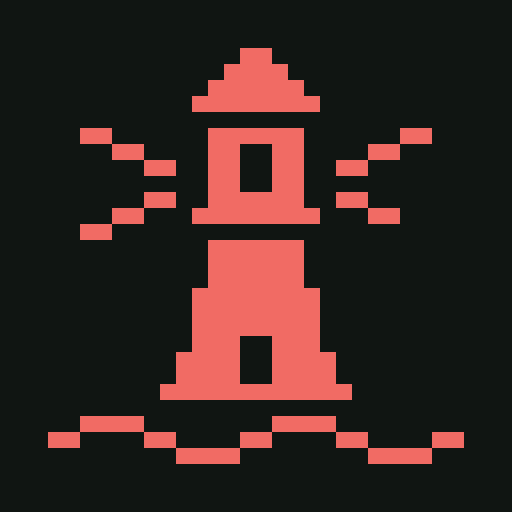
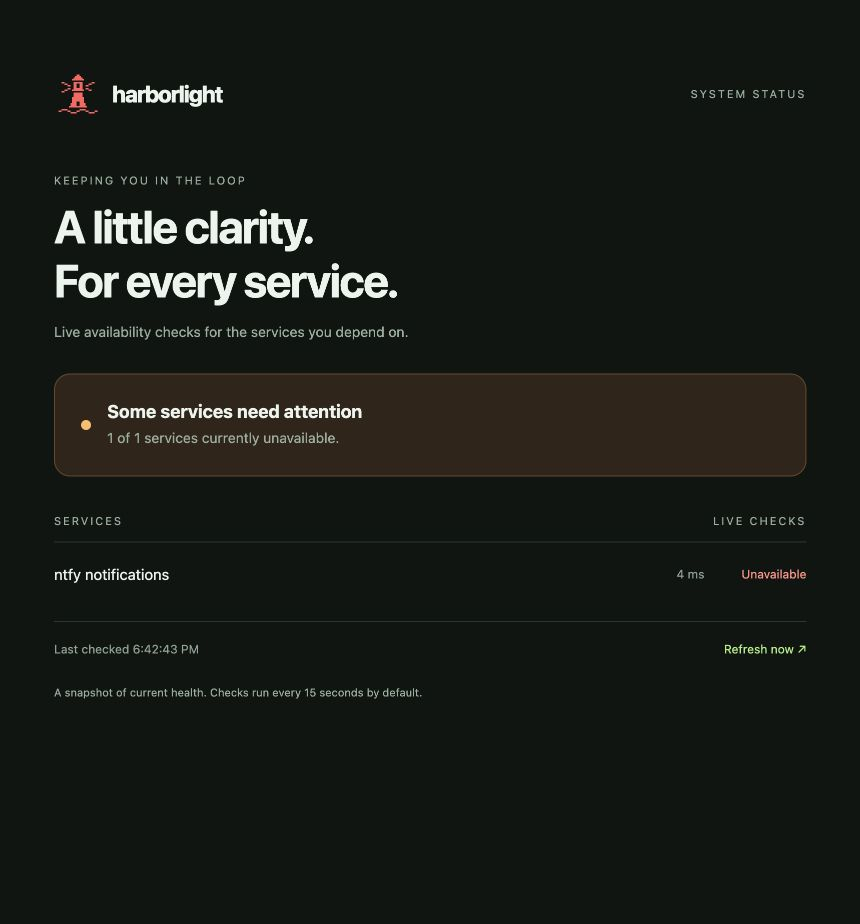

# Harborlight



A lightweight status page for real Kubernetes services. The main example deploys **ntfy**, an open-source notification server, using its published Helm chart. Harborlight checks ntfy over Kubernetes DNS and shows availability and response time.

## What runs

| Component | Helm release | Namespace | Purpose |
| --- | --- | --- | --- |
| ntfy | `ntfy` | `notifications` | Real HTTP publish/subscribe notification server |
| Harborlight | `demo` | `harborlight` | Checks ntfy's `/v1/health` endpoint |

The repository contains only the dashboard and the real ntfy deployment example.

ntfy's [official installation guide](https://docs.ntfy.sh/install/#helm) documents the **community-maintained HelmForge chart**. It is not an official ntfy-maintained chart. This example pins chart version **1.6.2**, which specifies upstream image `binwiederhier/ntfy:v2.31.1`. Chart source: [helmforgedev/charts](https://github.com/helmforgedev/charts/tree/main/charts/ntfy). Application source: [binwiederhier/ntfy](https://github.com/binwiederhier/ntfy).

## 1. Start Killercoda

Open the [Kubernetes playground](https://killercoda.com/playgrounds/scenario/kubernetes), sign in, and start the environment. In its terminal:

```sh
kubectl get nodes
helm version
```

Both nodes should be ready. If Helm is missing, follow its [official installation instructions](https://helm.sh/docs/intro/install/).

## 2. Clone and deploy both applications

```sh
git clone https://github.com/apmartins85/harborlight.git
cd harborlight
sh examples/ntfy/deploy.sh
```

If you already cloned the repository, run `git pull` from its directory before deploying. The script installs ntfy from the upstream chart repository, then installs/upgrades Harborlight. `--reset-values` clears settings from previous installations.

Equivalent commands:

```sh
helm repo add helmforge https://repo.helmforge.dev --force-update
helm repo update helmforge
helm upgrade --install ntfy helmforge/ntfy --version 1.6.2 \
  --namespace notifications --create-namespace \
  -f examples/ntfy/values.yaml --wait --timeout 180s
helm upgrade --install demo ./charts/harborlight \
  --namespace harborlight --create-namespace \
  --reset-values --wait --timeout 120s
kubectl -n notifications get pods,svc
kubectl -n harborlight get pods,svc
```

This lab disables ntfy persistence so it works without a storage provisioner. Its data disappears when the pod is replaced. The ntfy application is real; the deployment settings are intentionally temporary for Killercoda.

## 3. Open Harborlight

The default dashboard Service uses NodePort **30080**:

1. Open **☰ → Traffic / Ports** in the playground.
2. Under **Host 1 → Custom Ports**, enter **30080**.
3. Click **Access**. Harborlight opens in a separate tab.
4. After the first check, **ntfy notifications** should show **Operational**.

Do not reuse another session's URL: Killercoda generates a new hostname for every environment.

## 4. Port-forward Harborlight (alternative)

In a Killercoda terminal:

```sh
kubectl -n harborlight port-forward --address 0.0.0.0 svc/demo-harborlight 8080:80
```

Leave that terminal running. You should see `Forwarding from 0.0.0.0:8080 -> 8080`. Open **☰ → Traffic / Ports → Host 1 → 8080**. Use a second terminal for other commands. Ctrl+C stops forwarding.

For an internal-only dashboard Service, first run:

```sh
helm upgrade demo ./charts/harborlight -n harborlight --set service.type=ClusterIP --wait
```

The forwarding command works with either Service type. `--address 0.0.0.0` lets the Killercoda proxy connect; outside this lab, omit it to bind only to localhost. If a pod restarts and the forward stops, rerun the command. Your computer's `localhost:8080` is not the remote playground; use **Traffic / Ports**.

## 5. Open the real ntfy web app

In a separate Killercoda terminal:

```sh
kubectl -n notifications port-forward --address 0.0.0.0 svc/ntfy 8082:80
```

Keep it running, then open **Traffic / Ports → Host 1 → Custom Ports → 8082 → Access**. The ntfy web interface opens. Subscribe to a topic named `harborlight-lab` on this instance. Browser notifications are optional; the topic page displays messages without enabling them.

Publish a test message from inside the cluster. This request runs in the Harborlight pod so Kubernetes DNS resolves the ntfy Service:

```sh
kubectl -n harborlight exec deployment/demo-harborlight -- python -c \
  'import urllib.request; r=urllib.request.Request("http://ntfy.notifications.svc.cluster.local/harborlight-lab",data=b"Hello from Kubernetes",headers={"Title":"Harborlight test"}); print(urllib.request.urlopen(r, timeout=5).read().decode())'
```

Or, while the ntfy port-forward is active, use `curl -d 'Hello from Kubernetes' http://localhost:8082/harborlight-lab` in another Killercoda terminal. This sends only to your lab instance, not the public ntfy.sh service.

## 6. Test a real outage and recovery

Stop ntfy:

```sh
kubectl -n notifications scale deployment/ntfy --replicas=0
```

After pod termination and the next check, Harborlight shows ntfy as unavailable. Allow up to about one minute. Restore it:

```sh
kubectl -n notifications scale deployment/ntfy --replicas=1
kubectl -n notifications rollout status deployment/ntfy --timeout=120s
```

After readiness and the next check cycle, Harborlight returns to operational. Restart the ntfy port-forward if it stopped when its pod disappeared. The temporary ntfy message cache is lost when its pod is removed.

## Screenshots from Killercoda

### Application operational


### Application outage



## Monitor other services

Create `my-values.yaml`:

```yaml
services:
  - name: ntfy notifications
    url: http://ntfy.notifications.svc.cluster.local/v1/health
  - name: My API
    url: http://my-api.default.svc.cluster.local:8080/health
```

```sh
helm upgrade demo ./charts/harborlight -n harborlight -f my-values.yaml --wait
```

Harborlight checks every 15 seconds by default, with a three-second socket timeout per target. The page refreshes every five seconds. HTTP 200–399 responses count as operational; redirects are followed. This measures HTTP availability, not delivery of notifications or database health, and does not inspect ntfy's JSON `healthy` field. The publish/receive exercise tests application behavior separately.

## Development and troubleshooting

```sh
helm lint ./charts/harborlight
helm template demo ./charts/harborlight -n harborlight > /tmp/harborlight.yaml
kubectl -n harborlight logs deployment/demo-harborlight
kubectl -n notifications logs deployment/ntfy
kubectl -n notifications describe pods
```

Edit the dashboard source directly in `charts/harborlight/files/app.py` and `index.html`. These are the only copies. The source is mounted through ConfigMaps for a build-free lab. Chart configuration changes trigger a dashboard restart. Failed monitored checks do not restart Harborlight. If port 30080 is allocated, set `service.nodePort=30081` and open that port instead. Cluster image pulls require access to Docker Hub.

## Cleanup

```sh
helm uninstall demo -n harborlight
helm uninstall ntfy -n notifications
```

Namespaces remain. Killercoda sessions are temporary. This lab has anonymous ntfy read/write access; use test messages only. Persistent storage, authentication, TLS, and backups should be configured for a lasting deployment.

## Open-source licenses

Harborlight uses the [MIT license](LICENSE). ntfy and the HelmForge chart are separate upstream projects; their own [application license](https://github.com/binwiederhier/ntfy) and [chart license](https://github.com/helmforgedev/charts) apply.
