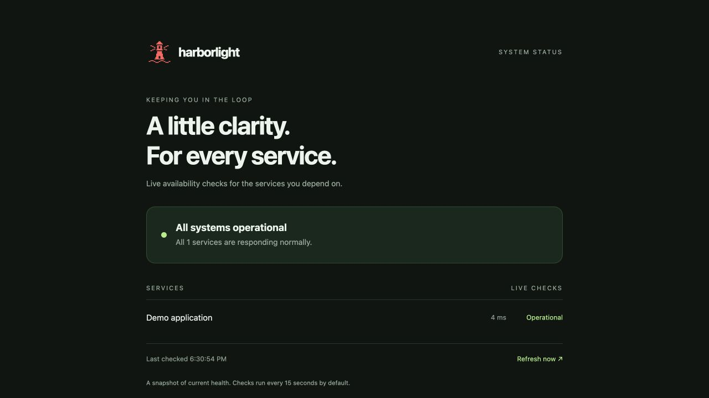
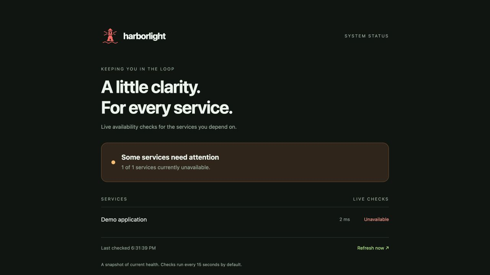

# Harborlight


A small lighthouse for your services: a lightweight status page that checks HTTP endpoints and shows availability and response times. Built with Python's standard library and plain HTML/CSS/JavaScript.

The Helm chart installs the dashboard **and a dummy application**. Use the dummy to practice outages and recovery in Killercoda, without a custom container build or external dependencies.

## Deploy on Killercoda

1. Open a Kubernetes playground and confirm the cluster is ready:

```sh
kubectl get nodes
helm version
```

If Helm is missing, install Helm using its official instructions: https://helm.sh/docs/intro/install/

2. Clone this repository:

```sh
git clone https://github.com/apmartins85/harborlight.git
cd harborlight
```

3. Install the chart (the command can also be used to upgrade):

```sh
helm upgrade --install demo ./charts/harborlight \
  --namespace harborlight --create-namespace \
  --wait --timeout 120s
kubectl -n harborlight get pods,svc
```

4. In Killercoda, open **Traffic / Ports** and access port **30080**. Wait for the first check to show **Demo application — Operational**. The page polls the API every five seconds; the server checks services every 15 seconds.

The Kubernetes resources are named `demo-harborlight` (dashboard) and `demo-harborlight-dummy` (dummy app).

## Simulate an outage and recovery

Stop the dummy application:

```sh
kubectl -n harborlight scale deployment/demo-harborlight-dummy --replicas=0
```

After pod termination and the next check, the dashboard should show it as unavailable (allow up to about one minute). Restore it:

```sh
kubectl -n harborlight scale deployment/demo-harborlight-dummy --replicas=1
kubectl -n harborlight rollout status deployment/demo-harborlight-dummy
```

After the pod is ready and the next health check completes, the dashboard returns to operational. A subsequent Helm upgrade resets the dummy replica count to the value in the chart (one by default).

Inspect the dummy's response from inside the cluster:

```sh
kubectl -n harborlight exec deployment/demo-harborlight -- \
  python -c 'import urllib.request; print(urllib.request.urlopen("http://demo-harborlight-dummy:8080/healthz").read().decode())'
```

It returns JSON: `{"service": "demo-app", "status": "ok"}`. Both `/` and `/healthz` return HTTP 200; unknown paths return 404. Its Service stays internal to the cluster.

## Monitor your own services

Create `my-values.yaml`:

```yaml
dummy:
  enabled: false
services:
  - name: Frontend
    url: http://frontend.default.svc.cluster.local/
  - name: API
    url: http://api.default.svc.cluster.local:8080/health
```

Apply your configuration:

```sh
helm upgrade --install demo ./charts/harborlight \
  --namespace harborlight --create-namespace \
  -f my-values.yaml --wait --timeout 120s
```

URLs must be reachable from the dashboard pod. The checker follows redirects and considers final HTTP responses from 200 through 399 healthy. Each check has a three-second socket timeout. Changes to the ConfigMap trigger a rolling restart through its checksum annotation.

## Useful chart settings

| Value | Default | Purpose |
| --- | --- | --- |
| `dummy.enabled` | `true` | Deploy and monitor the dummy app |
| `dummy.replicas` | `1` | Dummy pod count |
| `services` | `[]` | Additional named HTTP(S) targets |
| `service.type` | `NodePort` | Dashboard Service type |
| `service.nodePort` | `30080` | Port to open in Killercoda |
| `checkInterval` | `15` | Seconds between completed check cycles; minimum 5 |
| `image` | `python:3.12-alpine` | Python runtime image |
| `resources` | See values.yaml | Dashboard CPU and memory requests/limits |

Keep the default check interval for this lab. Results older than one minute are marked delayed. If port 30080 is already allocated, use `--set service.nodePort=30081` and open that port instead. For a second release, choose a different NodePort or use ClusterIP.

## Port-forward on Killercoda (alternative to NodePort)

1. In the Killercoda terminal, install or update the release with an internal Service:

```sh
helm upgrade --install demo ./charts/harborlight \
  --namespace harborlight --create-namespace \
  --set service.type=ClusterIP --wait --timeout 120s
```

2. Start a port-forward that the Killercoda web proxy can reach:

```sh
kubectl -n harborlight port-forward --address 0.0.0.0 svc/demo-harborlight 8080:80
```

Leave this terminal running. You should see `Forwarding from 0.0.0.0:8080 -> 8080`. Use a second terminal for other commands. Press Ctrl+C to stop forwarding.

3. Open the **☰ menu** in the top-right of the playground and choose **Traffic / Ports**.
4. On the **Traffic Port Accessor** page, find **Host 1** and click the common port **8080** (or type `8080` into its custom port field and click **Access**).
5. The Harborlight page opens in another browser tab. Wait for **Demo application — Operational** after the first check.

Do not use `localhost:8080` in your own browser for a remote Killercoda session: that points to your computer. Use the URL provided by Traffic / Ports. The URL changes with every playground session.

For the default NodePort installation, no port-forward is needed: open the same **Traffic / Ports** page, enter **30080** under **Host 1 → Custom Ports**, and click **Access**.

If you see a proxy error, confirm the forwarding command is still running, the port matches, and `kubectl -n harborlight get pods` shows ready pods. Port-forwarding can stop when its selected pod restarts; rerun the command if that happens. Outside a disposable lab, omit `--address 0.0.0.0` to bind only to localhost.

## Screenshots from Killercoda

### Service up

The dummy application responds through its Kubernetes Service; Harborlight shows its response time and operational state.



### Service unavailable

After scaling the dummy Deployment to zero, Harborlight reports an unavailable service. Allow time for pod termination and the next health check; detection can take longer than 20 seconds.



## Run locally

```sh
python3 -B app.py
```

Open http://localhost:8080. The local `services.json` intentionally contains one healthy self-check and one unreachable endpoint. Helm uses its own generated configuration and the actual dummy Deployment instead.

## Development and checks

The chart includes copies of the dashboard source so it can be installed directly from a clone. After editing `app.py` or `index.html`, synchronize them before committing:

```sh
sh scripts/sync-chart.sh
helm lint ./charts/harborlight
helm template demo ./charts/harborlight --namespace harborlight > /tmp/harborlight.yaml
```

The original non-Helm lab deployment is available through `sh deploy.sh`; it uses `services.json` and does not install the dummy. Prefer Helm for the complete demo. Do not run both in the same cluster with the default NodePort.

## Troubleshooting

```sh
kubectl -n harborlight get pods,svc,endpoints
kubectl -n harborlight logs deployment/demo-harborlight
kubectl -n harborlight describe pods
```

If image pulls fail, confirm the playground can reach Docker Hub. If a target is unavailable, check its Service name, namespace, port, and ready endpoints. The dashboard's own probes measure the dashboard server, so monitored outages do not restart it.

## Remove the demo

```sh
helm uninstall demo --namespace harborlight
```

This removes the chart's workloads, Services, and ConfigMaps. The namespace remains.

## Scope

This is a small learning utility with current health snapshots: no stored history, uptime percentages, alerts, authentication, or database. The public API exposes service names and check results, but omits target URLs. Source files are mounted through ConfigMaps for a build-free lab; a production deployment should package them in a versioned image. Killercoda sessions are temporary; keep your changes in Git.
